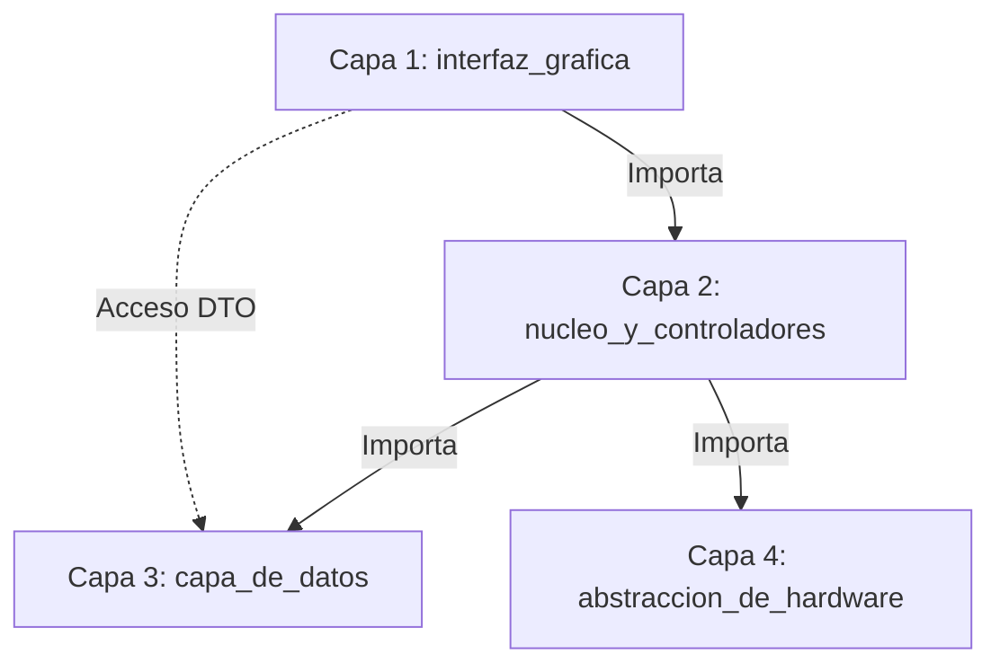

# 🚗 Escáner Automotriz Blar Plus


Sistema profesional de diagnóstico automotriz OBD-II desarrollado en Python 3.10+ y PySide6. Implementa una **arquitectura desacoplada de 4 capas** con muestreo en tiempo real a 10 Hz mediante comunicación serie (dispositivos USB ELM327) o emulación simulada. Desarrollado bajo la metodología **Scrumban** (3 Sprints de 5 días).

---

## 👥 Equipo de Desarrollo ("BLAR")

| Desarrollador | Rol / Capa Asignada | Módulo Principal |
| :--- | :--- | :--- |
| **Mendivil Jiménez José Luis** | Capa 4 — Abstracción de Hardware (HAL) | `abstraccion_de_hardware/` |
| **Chavarría Mendoza Antonio** | Capa 3 — Persistencia y Datos | `capa_de_datos/` |
| **Polanco Romero Erick** | Capa 2 — Núcleo y Concurrencia | `nucleo_y_controladores/` |
| **Estrada Loaiza Rogelio** | Capa 1 — Interfaz Gráfica (GUI) | `interfaz_grafica/` |

---

## 🏛 Arquitectura del Sistema (4 Capas)

El proyecto sigue una regla estricta de **importación unidireccional** (de Capa 1 hacia Capa 4), evitando ciclos de dependencia y garantizando el desacoplamiento total de componentes:

| Capa | Nombre del Módulo | Componentes Clave | Responsabilidad Técnica |
| :--- | :--- | :--- | :--- |
| **Capa 1** | `interfaz_grafica/` | `ventana_principal.py`<br>`barra_estado.py`<br>`lista_dtc.py`<br>`dialogo_confirmacion.py`<br>`grafico_tiempo_real.py` | Presentación responsiva con PySide6. Vistas alternativas para Conductor y Mecánico, tabla condicional por severidad, gráficos en tiempo real y modales de seguridad. |
| **Capa 2** | `nucleo_y_controladores/` | `trabajador_obd.py`<br>`controlador_reporte.py` | Lógica de control y concurrencia. `QThread` secundario para sondeos a 10 Hz sin congelar la GUI, emisión de señales Qt y mapeo DTO (`DTCDTO`). |
| **Capa 3** | `capa_de_datos/` | `gestor_bd.py`<br>`enriquecedor.py`<br>`cliente_rest.py`<br>`modelo_reporte.py`<br>`inicializar_db.py` | Persistencia y orquestación. Consultas locales parametrizadas a SQLite (`dtc_database.db`), integración con API REST HTTP para diagramas y construcción del DTO `DTCReporte`. |
| **Capa 4** | `abstraccion_de_hardware/` | `i_adaptador_obd.py`<br>`adaptador_elm327.py`<br>`adaptador_simulador.py`<br>`estrategias_protocolo.py` | Hardware Abstraction Layer (HAL). Interfaz abstracta ABC, emulador Mock de datos, driver serie real (`PySerial`) y decodificador hexadecimal de comandos SAE J1979. |

---

## 🛠️ Stack Tecnológico

* **Lenguaje:** Python 3.10+
* **Interfaz Gráfica:** PySide6 (Qt6)
* **Gráficos en Tiempo Real:** PyQtGraph
* **Comunicación Serie:** PySerial (Microcontroladores ELM327 USB / FTDI / CH340 / PL2303)
* **Persistencia Base de Datos:** SQLite3
* **Protocolo y Red:** Requests (API REST HTTP)
* **Pruebas Unitarias:** PyTest & PyTest-Qt (`pytest-qt`)

---

## 🔌 Requisitos de Hardware (Para Pruebas Reales)

* **Interfaz:** Escáner Automotriz OBD-II a USB con chip ELM327 (versiones v1.5 o v2.1).
* **Controladores USB-Serial Soportados:** Chips FTDI FT232RL, CH340 o PL2303.
* **Velocidad de Puerto Serie:** 38,400 o 115,200 baudios (bauds).
* **Conector Vehicular:** Puerto J1962 de 16 pines (DLC).

---

## ⚙️ Instalación y Configuración (Ubuntu Linux 22.04 / 24.04 LTS)

### 1. Clonar el repositorio
```bash
git clone https://github.com/biggerihus/blar_plus.git
cd blar_plus
```

### 2. Configurar permisos del puerto serie (OBLIGATORIO)
Para acceder a los puertos `/dev/ttyUSB0` o `/dev/ttyACM0` sin requerir `sudo`:
```bash
sudo usermod -a -G dialout $USER
```
> **Nota:** Se debe cerrar e iniciar sesión (o reiniciar el equipo) para aplicar el cambio de grupo.

### 3. Crear y activar entorno virtual Python
```bash
python3 -m venv venv
source venv/bin/activate
```

### 4. Instalar dependencias
```bash
pip install --upgrade pip
pip install -r requirements.txt
```

### 5. Inicializar la base de datos SQLite local
```bash
python3 capa_de_datos/inicializar_db.py
```

---

## 🚀 Uso del Sistema

La aplicación soporta selección dinámica de hardware mediante argumentos de consola:

### Modo Simulador (Pruebas de desarrollo sin vehículo ni cable)
```bash
python3 main.py --modo simulador
```

### Modo Real (Conexión con escáner ELM327 USB en vehículo)
```bash
python3 main.py --modo real --puerto /dev/ttyUSB0
```

---

## 🧪 Suite de Pruebas Unitarias (`pytest`)

El proyecto cuenta con una suite completa de 16 pruebas integradas que evalúan todas las capas del sistema:

```bash
# Ejecutar la suite global de pruebas en modo detallado
python3 -m pytest tests/ -v
```

### Desglose de Cobertura de Pruebas:
* `tests/test_hardware.py`: Conexión, lectura Mock, decodificación Hex SAE J1979 y manejo de errores HAL. **(5/5 Passed)**
* `tests/test_datos.py`: Consultas SQLite, tolerancia a fallos de red y construcción de DTOs. **(3/3 Passed)**
* `tests/test_control.py`: Concurrencia a 10 Hz (`QThread`), emisión de señales Qt y catálogo de fallas. **(4/4 Passed)**
* `tests/test_gui.py`: Navegación entre vistas PySide6, tabla dinámica de severidad y diálogos modales. **(4/4 Passed)**

---

## 🏗️ Jerarquía del Proyecto y Diagramas

```mermaid
flowchart TD
    Root["📁 blar_plus/"]

    C1["📁 interfaz_grafica/ (Capa 1: GUI)"]
    C1_1["📄 ventana_principal.py"]
    C1_2["📄 barra_estado.py"]
    C1_3["📄 lista_dtc.py"]
    C1_4["📄 dialogo_confirmacion.py"]
    C1_5["📄 grafico_tiempo_real.py"]

    C2["📁 nucleo_y_controladores/ (Capa 2: Control)"]
    C2_1["📄 trabajador_obd.py"]
    C2_2["📄 controlador_reporte.py"]

    C3["📁 capa_de_datos/ (Capa 3: Datos)"]
    C3_1["📄 gestor_bd.py"]
    C3_2["📄 enriquecedor.py"]
    C3_3["📄 cliente_rest.py"]
    C3_4["📄 modelo_reporte.py"]
    C3_5["📄 inicializar_db.py"]
    C3_6["💾 dtc_database.db"]

    C4["📁 abstraccion_de_hardware/ (Capa 4: Hardware)"]
    C4_1["📄 i_adaptador_obd.py"]
    C4_2["📄 adaptador_elm327.py"]
    C4_3["📄 adaptador_simulador.py"]
    C4_4["📄 estrategias_protocolo.py"]

    TESTS["📁 tests/ (Suite de Pruebas)"]
    T1["📄 test_hardware.py"]
    T2["📄 test_datos.py"]
    T3["📄 test_control.py"]
    T4["📄 test_gui.py"]

    R1["🐍 main.py"]
    R2["📋 requirements.txt"]
    R3["⚙️ pytest.ini"]
    R4["📝 README.md"]

    Root --> C1
    C1 --> C1_1 & C1_2 & C1_3 & C1_4 & C1_5

    Root --> C2
    C2 --> C2_1 & C2_2

    Root --> C3
    C3 --> C3_1 & C3_2 & C3_3 & C3_4 & C3_5 & C3_6

    Root --> C4
    C4 --> C4_1 & C4_2 & C4_3 & C4_4

    Root --> TESTS
    TESTS --> T1 & T2 & T3 & T4

    Root --> R1 & R2 & R3 & R4
```



### Flujo Unidireccional de Importaciones



---

## 📄 Licencia

Este proyecto se distribuye bajo la licencia **MIT**. Para más detalles, consulta el archivo de licencia correspondiente.