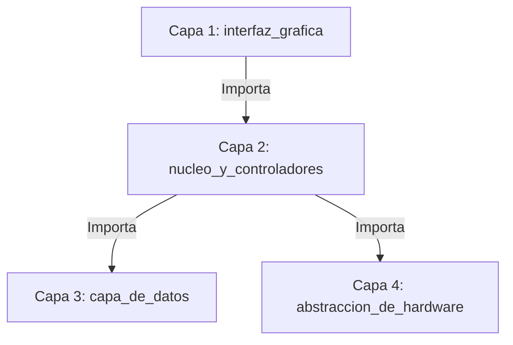

# 🚗 Escáner Automotriz Blar Plus

Sistema de diagnóstico automotriz profesional desarrollado en Python 3.10+ y PySide6 bajo la metodología **Scrumban** (Plazo de 15 días).

## 👥 Equipo de Desarrollo ("BLAR")
* **Mendivil Jiménez José Luis** — Desarrolador
* **Chavarría Mendoza Antonio** — Desarrollador
* **Estrada Loaiza Rogelio** — Desarrollador
* **Polanco Romero Erick** — Desarrollador

## 🛠️ Stack Tecnológico
* **Lenguaje:** Python 3.10+
* **Interfaz Gráfica:** PySide6 (Qt6) & PyQtGraph
* **Comunicación Hardware:** PySerial (Chip ELM327 USB)
* **Persistencia:** SQLite (`Wal33D` Extended) & API REST HTTP

## 🚀 Configuración del Entorno de Desarrollo (Ubuntu Linux)

```bash
# 1. Clonar el repositorio
git clone [https://github.com/biggerihus/blar_plus.git](https://github.com/biggerihus/blar_plus.git)
cd blar_plus

# 2. Permisos de puerto USB (Reiniciar sesión tras ejecutar)
sudo usermod -a -G dialout $USER

# 3. Crear y activar entorno virtual
python3 -m venv venv
source venv/bin/activate

# 4. Instalar dependencias
pip install -r requirements.txt
```
## 🏗️ Arquitectura del Proyecto

```mermaid
flowchart TD
    Root["📁 blar_plus/"]

    C1["📁 interfaz_grafica/ (Capa 1: Presentación)"]
    C1_1["📄 ventana_principal.py"]
    C1_2["📄 barra_estado.py"]
    C1_3["📄 lista_dtc.py"]
    C1_4["📄 dialogo_confirmacion.py"]
    C1_5["📄 grafico_tiempo_real.py"]

    C2["📁 nucleo_y_controladores/ (Capa 2: Control)"]
    C2_1["📄 trabajador_obd.py"]
    C2_2["📄 controlador_reporte.py"]

    C3["📁 capa_de_datos/ (Capa 3: Datos)"]
    C3_1["📄 gestor_bd.py"]
    C3_2["📄 enriquecedor.py"]
    C3_3["📄 cliente_rest.py"]
    C3_4["📄 modelo_reporte.py"]
    C3_5["💾 dtc_database.db"]

    C4["📁 abstraccion_de_hardware/ (Capa 4: Hardware)"]
    C4_1["📄 i_adaptador_obd.py"]
    C4_2["📄 adaptador_elm327.py"]
    C4_3["📄 adaptador_simulador.py"]
    C4_4["📄 estrategias_protocolo.py"]

    R1["🐍 main.py"]
    R2["📋 requirements.txt"]
    R3["🛡️ .gitignore"]
    R4["📝 README.md"]

    Root --> C1
    C1 --> C1_1
    C1 --> C1_2
    C1 --> C1_3
    C1 --> C1_4
    C1 --> C1_5

    Root --> C2
    C2 --> C2_1
    C2 --> C2_2

    Root --> C3
    C3 --> C3_1
    C3 --> C3_2
    C3 --> C3_3
    C3 --> C3_4
    C3 --> C3_5

    Root --> C4
    C4 --> C4_1
    C4 --> C4_2
    C4 --> C4_3
    C4 --> C4_4

    Root --> R1
    Root --> R2
    Root --> R3
    Root --> R4
```



## 🔄 Flujo de Importaciones entre Capas


